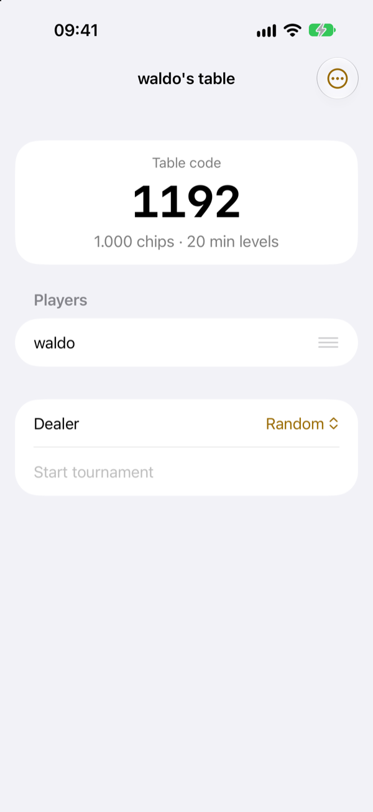
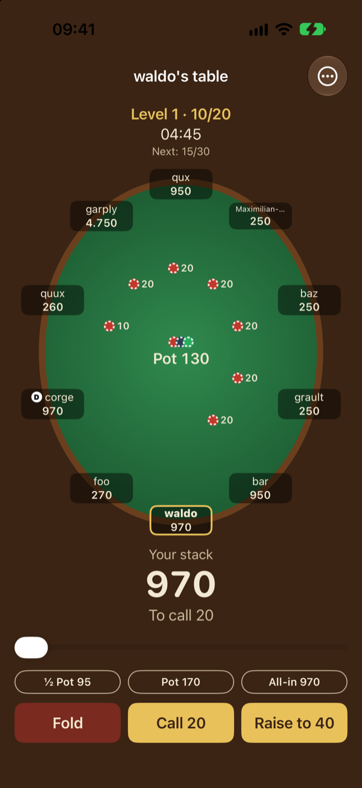
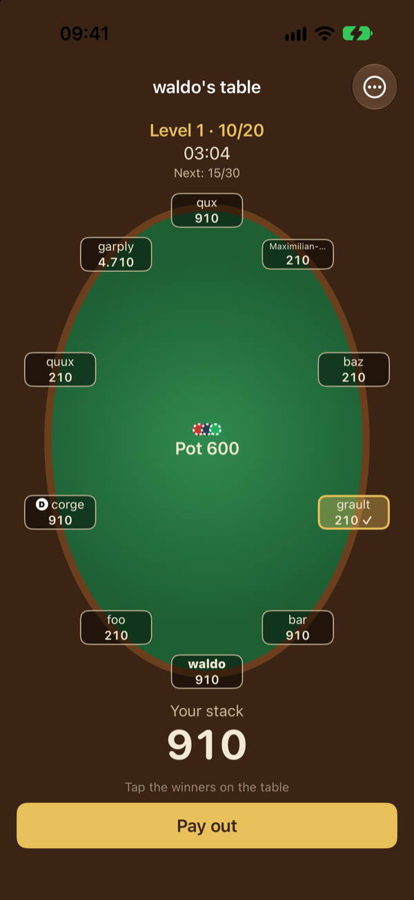
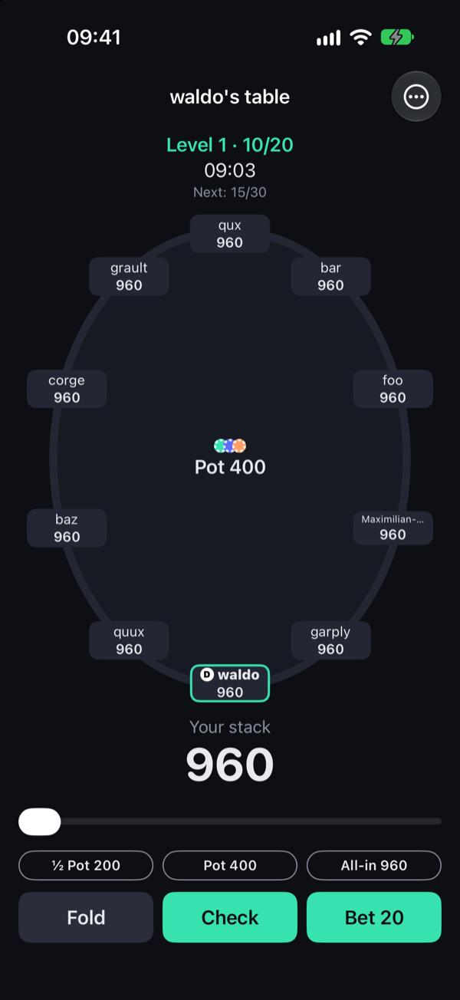

# PokerChipCase

An iOS app that replaces the poker chip case at a Texas Hold'em night among friends – everything except the deck of cards. Players use real cards, every player uses the app on their own iPhone, and betting happens in the app. Play money only, no real money.

<p>
  
  
  
  
</p>

## How a game night works

1. The host creates a table and picks how fast the blinds rise. The app shows a 4-digit table code.
2. The other players open the app, see the table nearby and join with the code.
3. The host starts the tournament. The app posts the blinds, tracks whose turn it is, and keeps the pots, including side pots for all-ins.
4. The cards are real. At the showdown the dealer or the host taps the winner of each pot, and the app pays out.
5. The blind clock raises the blinds level by level until one player has all the chips. The ranking shows who went out when.

No account, no server, no internet. The phones talk directly over the local Wi-Fi or Apple's peer-to-peer Wi-Fi, encrypted with a key derived from the table code.

## Features

- Fold, check, call, raise and all-in, with the rules enforced by the host
- Side pots, split between the eligible players
- Blind clock with pause and resume
- Undo for the host
- The host's table survives an app restart, and players get their seat back after a dropped connection
- Felt, Dark and System appearance

## Status

Early and in active development. There is no App Store release yet; build it yourself to try it.

## Requirements

- iPhone with iOS 17 or later
- To build: a Mac with Xcode (Swift 6) and [XcodeGen](https://github.com/yonaskolb/XcodeGen)

## Build

```sh
brew install xcodegen
xcodegen generate --spec App/project.yml
open App/PokerChipCase.xcodeproj
```

For a real device create `App/Config/Local.xcconfig` with `DEVELOPMENT_TEAM = <your team ID>` (and, if needed, your own `PRODUCT_BUNDLE_IDENTIFIER`). Edit `App/project.yml`, never the generated project or `Info.plist`.

To try it on one simulator, launch the app with the argument `-debugTable`: it creates a table, fills it with bots and starts.

## Test

`swift test` (macOS, no iPhone needed). The app itself is tested manually in several simulators.

## Project layout

| Path | Contents |
| --- | --- |
| `Sources/PokerCore` | Game rules, pots, commands, wire types. Foundation only. |
| `Sources/PokerNet` | Discovery, encrypted connections, host and client. Depends on PokerCore. |
| `Sources/PokerSession` | Session state and the save file. Depends on PokerCore and PokerNet. |
| `App/Sources` | The SwiftUI app. |
| `Tests` | Swift Testing, one target per library. |

The package has no third-party dependencies: besides its own modules it uses only Apple frameworks (Foundation, Network, CryptoKit, Observation, SwiftUI). So there is no `Package.resolved` to lock.

## Protocol

The host is the source of truth; players send commands and receive the table state. [Sources/PokerNet/PokerNet.docc/Protocol.md](Sources/PokerNet/PokerNet.docc/Protocol.md) describes the wire format in enough detail to write a compatible client for another platform, such as Android. The API reference and the protocol are also online at <https://mauwii.github.io/pokerchipcase/documentation/>.

## Contributing

See [CONTRIBUTING.md](CONTRIBUTING.md). Security issues: [SECURITY.md](SECURITY.md).

## License

[MIT](LICENSE)
